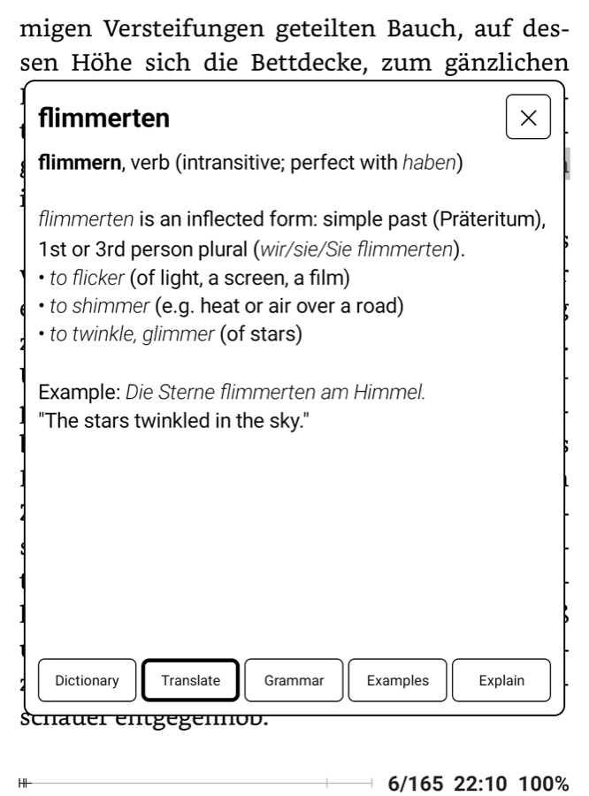
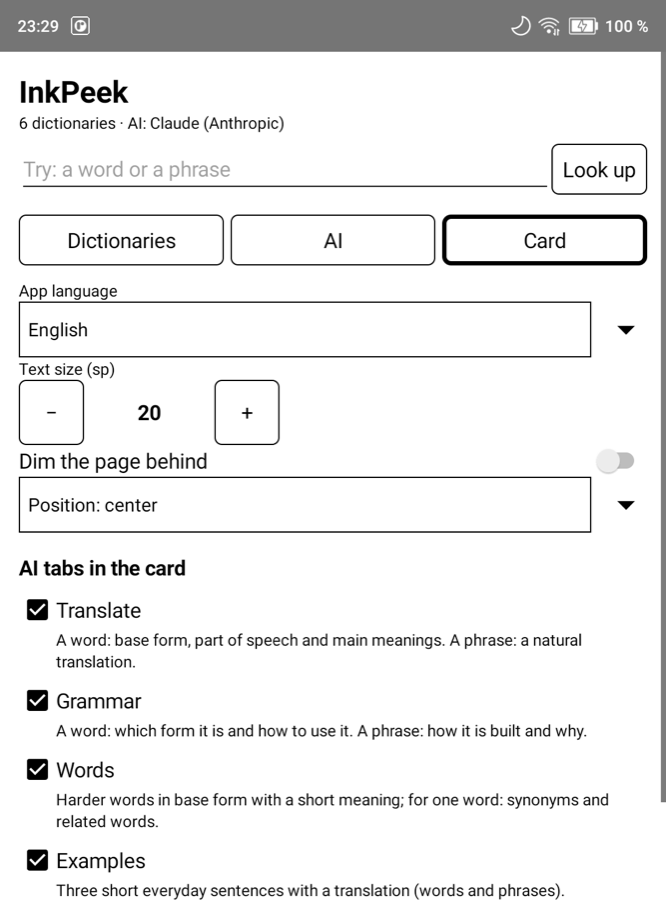

<p align="center"></p>

# InkPeek

**Read books in a language you are learning without leaving the page.**

Tap a word or select a sentence in your e-book reader. A calm black-and-white card opens over the page with the
dictionary entry, a translation that fits the context, and short explanations from an AI tutor. Close the card and
you are back on the same line.

Made for Android e-ink readers (Onyx Boox and others); works on any Android device.

## What you can do

<table>
<tr>
<td width="33%"></td>
<td width="33%"></td>
<td width="33%"></td>
</tr>
<tr>
<td valign="top"><b>Look up a word.</b> Entries from your own dictionaries, offline. Inflected forms find their base
form: <i>Träumen</i> → <i>Traum</i>.</td>
<td valign="top"><b>Translate a sentence or a paragraph.</b> A natural translation, not word by word, in the language
you choose.</td>
<td valign="top"><b>Understand why it is said this way.</b> Word order, forms and the rule behind them, with the words
from the text in bold.</td>
</tr>
<tr>
<td width="33%"></td>
<td width="33%"></td>
<td width="33%"></td>
</tr>
<tr>
<td valign="top"><b>Get the meaning that fits here.</b> The header shows the base form with its article and plural,
or a verb's forms; Translate gives the main meanings, Analysis the grammar and related words, Context examples.</td>
<td valign="top"><b>No internet? Still useful.</b> A selected sentence gets a word-by-word gloss from your
dictionaries. Tap a word to open its full entry.</td>
<td valign="top"><b>Keep what you look up.</b> AI answers are saved and shown again, also offline; ☆ keeps a word or
phrase in My words. Use Claude, OpenAI, OpenRouter (it has free models) or your own server.</td>
</tr>
</table>

<p align="center"><sub>Onyx Boox Go 6, FBReader, Franz Kafka «Die Verwandlung» (public domain). Answers here are in
English or Russian: you choose the answer language.</sub></p>

## Quick start
1. **Install** the APK from [Releases](https://github.com/kafeg/inkpeek/releases) and open InkPeek. Allow access to
   files when it asks.
2. **Choose your languages:** Languages → the language of the answers, tick the languages of your books → Download.
3. **Optional — AI:** choose a provider on the **AI** tab and paste your API key.
4. **Connect your reader** (below). In FBReader this is two settings.

## Connect your reader

### FBReader (the free version is enough)
Open **Settings → Dictionary & translator** and set **both**:
- **Look up single word in** → **ColorDict 3**
- **Translate phrases via** → **ColorDict 3**

The default phrase translator is Google Translate, a Premium feature: if you see "buy Premium" when you select a
phrase, this setting is the fix.

| a word | a sentence or a paragraph |
|---|---|
| Long-tap the word, then the **translate** button (文A). | Long-tap, drag the handle to the end of the text, then **translate** (文A). |
|   |   |
| The card opens on the dictionary. | The card opens on Translate (or on the gloss, without AI). |

Tip: in **Settings → Dictionary**, set the long-tap action to **select single word, release to open dictionary**.
Then one gesture opens a word.

### KOReader
KOReader calls only the dictionary apps it knows. Add InkPeek to the list with one file,
`/sdcard/koreader/dictionaries.lua`:

```lua
return {
    { "InkPeek", "InkPeek", false, "io.github.kafeg.inkpeek", "text" },
}
```

Restart KOReader. Then **Settings → Dictionary settings → Use external dictionary**, and **Dictionary: InkPeek**.
A word or a selection now opens in InkPeek. This file replaces KOReader's built-in list of external dictionaries;
copy other entries from
[device.lua](https://github.com/koreader/koreader/blob/master/frontend/device/android/device.lua) if you need them.

### Other readers
| reader | how |
|---|---|
| Cool Reader | Settings → Dictionary → **ColorDict new / GoldenDict** |
| Moon+ Reader | Dictionary → **ColorDict** |
| any app | text selection menu → **Look up in InkPeek**, or Share → InkPeek |

If another dictionary app answers the same request, Android asks which one to use: choose InkPeek → Always.

## How it works

### The card
- **Dictionary** comes first. For a word: entries from your dictionaries, one dictionary per screen, ◀ ▶ to page
  between them; dictionaries in your answer language come first. For a sentence: the word-by-word gloss.
- **AI tabs:** Translate, Grammar, Words, Examples, Explain. A tab asks the AI only when you open it, and keeps the
  answer while the card is open. Switching tabs does not ask again.
- What you selected decides what the tabs do: one word, a short phrase (up to 8 words), or a passage (longer, or more
  than one sentence; Examples is hidden for a passage).
- A selected sentence opens on Translate when AI is on (you can turn this off).
- Built for e-ink: black on white, large text, no animations, few settings.
- The app is in English, Русский and Deutsch — exactly the answer languages of InkPeek's language packs; a new
  language comes with its packs. AI answers come in the language you choose.

### Languages
Settings → **Languages**: the language of the answers and the languages of your books. For each book language InkPeek
downloads one language pack from this project's [`packs` release](https://github.com/kafeg/inkpeek/releases/tag/packs)
— nothing comes from other servers:

| part | what it gives | from |
|---|---|---|
| dictionary of the pair | a short first line — "das Haus (Hauses, мн. Häuser) — дом, здание", "go (went, gone) неправ. — идти" — and the full article; every inflected form finds its word (Häusern, ging, went) | Wiktionary via [kaikki.org](https://kaikki.org), [WikDict](https://www.wikdict.com) |
| grammar | gender, plural, verb forms; which language a text is in | Wiktionary via kaikki.org |
| offline translation | Translate without the internet | [Firefox Translations](https://github.com/mozilla/translations) models |
| language identification | which language you selected, also one without a pack | [fastText](https://fasttext.cc) lid.176 |

Packs now: German → Russian, English → Russian, German → English, English → German, Russian → German (smaller).
They are built by [`packs/`](packs/README.md) and checked by tests before they are published. A German pack with
Russian answers is about 67 MB, English with Russian about 49 MB (the English → Russian model is shared).

**Your own dictionaries:** import StarDict as `.zip`, `.tar`, `.tar.gz`, `.tar.bz2`, `.tar.xz`, `.tar.zst`, or loose
`.ifo` / `.idx` / `.dict(.dz)` / `.syn` files, or copy a folder into `/sdcard/InkPeek/dicts/`. They come after the
packs in the card. InkPeek builds its own index for each dictionary once, in the background.

### Offline translation
The Translate tab works without the internet: the [Bergamot](https://github.com/browsermt/bergamot-translator) engine
runs the models of the language packs on the device. The language of the selection is found by fastText and
confirmed by the grammar; a text in a language without a pack is named as such ("This looks like French").

**It goes through English.** Mozilla trains every model to or from English, so German → Russian is German →
English → Russian. The meaning comes through; nuances can get lost: *du* and *Sie* both become *you*, so the Russian
may pick the wrong one of ты / вы; the speaker's gender may change.

On a Boox Go 6 (Snapdragon 662, 2 GB) a sentence takes 0.2–0.9 s with both models in memory (about 560 MB), or 1–2 s
when free memory is short and InkPeek loads one model at a time. With AI set up, Translate asks AI first (setting).

### AI
Providers: **Claude** (Anthropic), **OpenAI**, **OpenRouter** (hundreds of models, some free), and **any
OpenAI-compatible server** — your own or a cloud one. The model list has a search, a maker filter, "free only" and
sorting. For your own server, pick a preset and change the address if needed; a local server needs no key.

Answers should come in seconds, so InkPeek asks every model to skip its reasoning pass where the provider allows
it. Claude defaults to Sonnet 5.5; Haiku 5.5 is faster and cheaper but weaker on grammar, Opus 5.5 deeper but slower. When a
provider refuses access (403), it often blocks the country: a VPN helps.

| preset | address |
|---|---|
| LM Studio | `http://<computer IP>:1234/v1` |
| Ollama | `http://<computer IP>:11434/v1` |
| llama.cpp server | `http://<computer IP>:8080/v1` |
| vLLM | `http://<computer IP>:8000/v1` |
| Groq | `https://api.groq.com/openai/v1` |
| DeepSeek | `https://api.deepseek.com/v1` |
| Qwen (Alibaba Cloud) | `https://dashscope-intl.aliyuncs.com/compatible-mode/v1` |
| Mistral | `https://api.mistral.ai/v1` |
| Google Gemini | `https://generativelanguage.googleapis.com/v1beta/openai` |

A local server must listen on the network, not only on localhost (LM Studio: "Serve on Local Network"; Ollama:
`OLLAMA_HOST=0.0.0.0`). A small local model can be slow; InkPeek waits up to 2 minutes for it.

Put the key in settings, or in a file:

```
/sdcard/InkPeek/keys/anthropic.key
/sdcard/InkPeek/keys/openai.key
/sdcard/InkPeek/keys/openrouter.key
/sdcard/InkPeek/keys/custom.key
```

```bash
adb push openrouter.txt /sdcard/InkPeek/keys/openrouter.key
```

**Privacy:** only the selected text and the tab's request go to the provider you chose, only when you open an AI tab
(or select a phrase with "phrases: AI at once" on). No telemetry, no accounts.

### Protocol
| intent | text extra | notes |
|---|---|---|
| `colordict.intent.action.SEARCH` | `EXTRA_QUERY` | the ColorDict / GoldenDict protocol; `EXTRA_GRAVITY`, `EXTRA_HEIGHT` and `EXTRA_FULLSCREEN` are ignored |
| `android.intent.action.PROCESS_TEXT` | `EXTRA_PROCESS_TEXT` | system selection menu, KOReader |
| `android.intent.action.SEND` (`text/plain`) | `EXTRA_TEXT` | Share |

Test from a computer: `adb shell am start -a colordict.intent.action.SEARCH --es EXTRA_QUERY Haus`

## Install and build
Release APKs are built and signed by [GitHub Actions](.github/workflows/release.yml) from the tagged commit; each has
a `.sha256` file.

```bash
./gradlew testDebugUnitTest assembleDebug
adb install -r app/build/outputs/apk/debug/app-debug.apk
```

Kotlin, Android Views, Android 11+ (minSdk 30), 64-bit ARM. The translation engine is C++ built with the NDK:
`git clone --recurse-submodules` (or `git submodule update --init --recursive`). Design notes: [docs/spec.md](docs/spec.md).

## License
MIT. Language packs: dictionaries and grammar CC BY-SA 4.0 (Wiktionary contributors, Wiktextract/kaikki.org, WikDict), translation models MPL-2.0 (Mozilla), language identification CC BY-SA 3.0 (fastText). Dictionaries you import keep their own licenses.

Third-party code and data: [Bergamot translator](https://github.com/browsermt/bergamot-translator) with marian
(MPL-2.0; the Android build from [RTranslator](https://github.com/niedev/RTranslator)'s fork); the JNI bridge
adapts RTranslator's `BergamotTranslator.cpp` (Apache-2.0, Luca Martino); translation models from Mozilla
(MPL-2.0), downloaded at run time, not in the APK.
