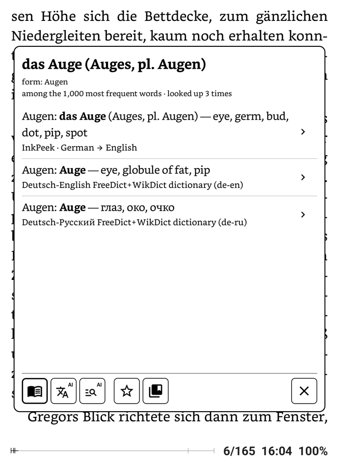
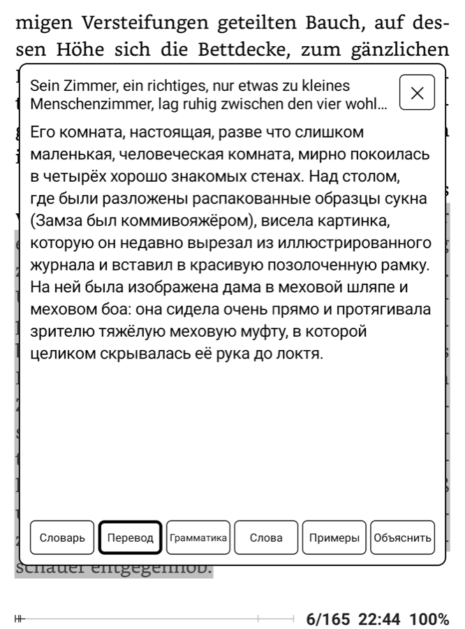
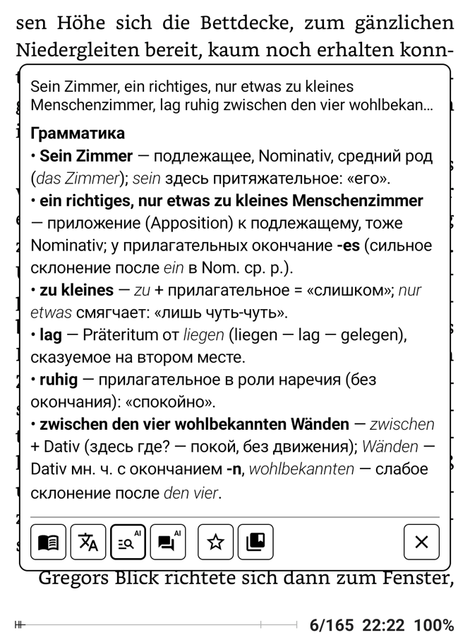
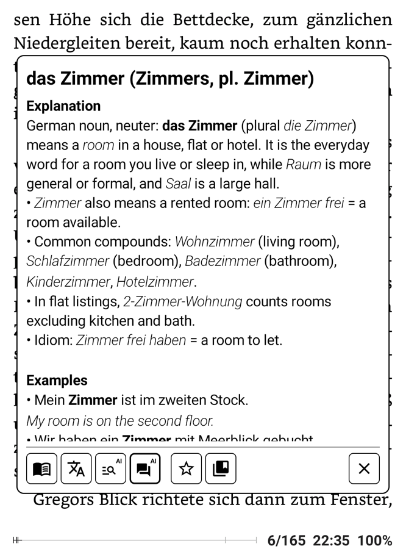
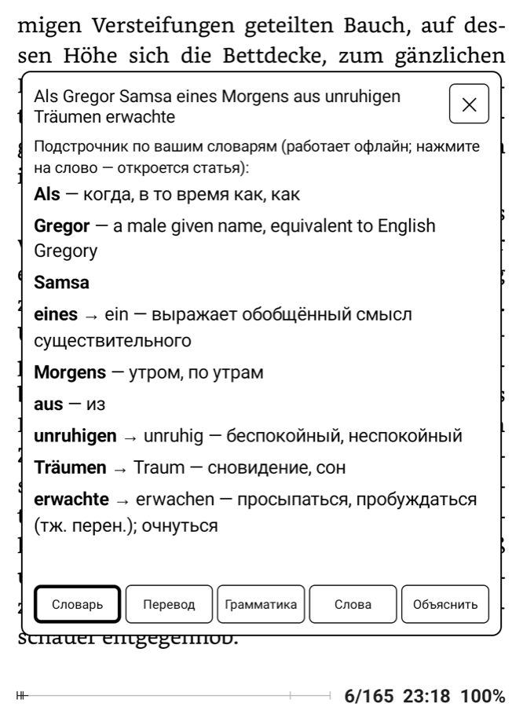
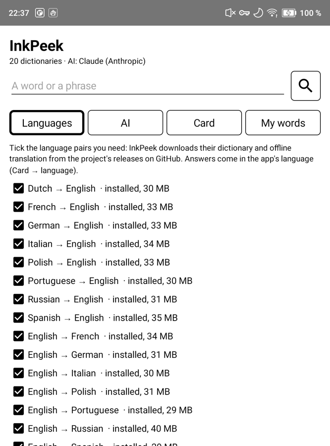
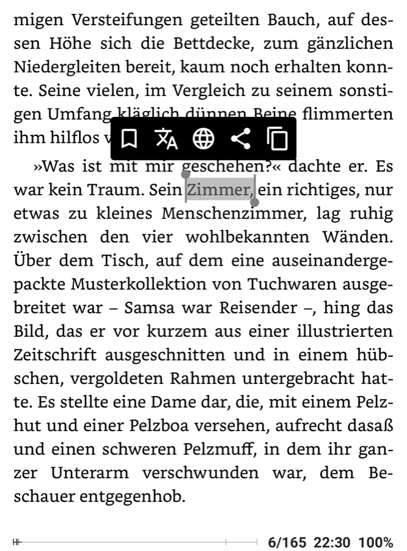
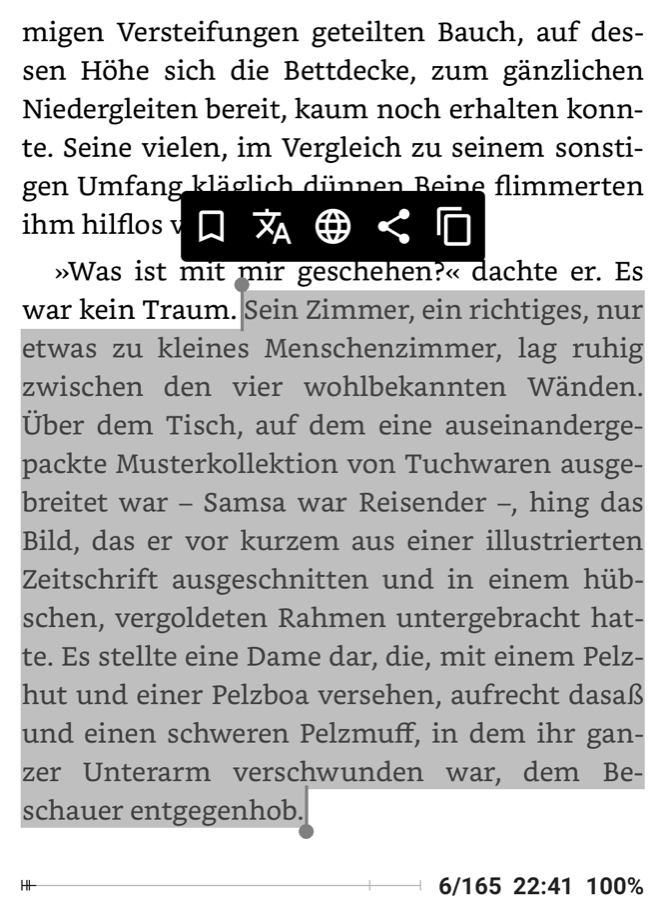

<p align="center"></p>

# InkPeek

**Read books in a language you are learning without leaving the page.**

Tap a word or select a sentence in your e-book reader. A calm black-and-white card opens over the page with the
dictionary entry, a translation that fits the context, and short explanations from an AI tutor. Close the card and
you are back on the same line.

It is also a plain offline pop-up dictionary when you want one: your own StarDict dictionaries (KOReader's folder
works as it is), a small card at the edge of the page, white on black if you like, and no AI at all.

Made for Android e-ink readers (Onyx Boox and others); works on any Android device.

## What you can do

<table>
<tr>
<td width="33%"></td>
<td width="33%"></td>
<td width="33%"></td>
</tr>
<tr>
<td valign="top"><b>Look up a word.</b> Entries from the language packs, offline. Inflected forms find their base
form: <i>Träumen</i> → <i>Traum</i>.</td>
<td valign="top"><b>Translate a sentence or a paragraph.</b> On the device, without the internet; or by AI when
you set it up.</td>
<td valign="top"><b>Understand why it is said this way.</b> Analysis (AI): Grammar — which form, how it is built,
the rule behind it — and Words.</td>
</tr>
<tr>
<td width="33%"></td>
<td width="33%"></td>
<td width="33%"></td>
</tr>
<tr>
<td valign="top"><b>See it in use.</b> Context (AI): Explanation — what it means here, register, idioms — and
Examples with a translation.</td>
<td valign="top"><b>Word by word, offline.</b> A selected sentence is translated word by word from the language packs: each word with
its base form and meaning. Tap a word to open its entry.</td>
<td valign="top"><b>Choose your languages.</b> Download the pairs you read: each pack brings a dictionary, grammar and
offline translation. Add your own StarDict dictionaries next to them.</td>
</tr>
</table>

<p align="center"><sub>Onyx Boox Go 6, FBReader, Franz Kafka «Die Verwandlung» (public domain), German → English.
Answers come in the app's language.</sub></p>

## Quick start
1. **Install** the APK from [Releases](https://github.com/kafeg/inkpeek/releases) and open InkPeek. Allow access to
   files when it asks.
2. **Choose your languages:** Languages → InkPeek → **Download packs…** → tap the pairs of your books. Answers come in
   the app's language. Have dictionaries already? Languages → **Other dictionaries** (below).
3. **Optional — AI:** choose a provider on the **AI** tab and paste your API key. Without it InkPeek works fully
   offline.
4. **Connect your reader** (below). In FBReader this is two settings.

## Connect your reader

### FBReader (the free version is enough)
Open **Settings → Dictionary & translator** and set **both**:
- **Look up single word in** → **ColorDict 3**
- **Translate phrases via** → **ColorDict 3**

The default phrase translator is Google Translate, a Premium feature: if you see "buy Premium" when you select a
phrase, this setting is the fix.

| a word | a sentence or a paragraph |
|---|---|
| Long-tap the word, then the **translate** button (文A). | Long-tap, drag the handle to the end of the text, then **translate** (文A). |
|   |   |
| The card opens on the dictionary. | The card opens on Translate (or on the word-by-word translation when there is no translation: no pack, no AI). |

Tip: in **Settings → Dictionary**, set the long-tap action to **select single word, release to open dictionary**.
Then one gesture opens a word.

### KOReader
KOReader calls only the dictionary apps it knows. Add InkPeek to the list with one file,
`/sdcard/koreader/dictionaries.lua`:

```lua
return {
    { "InkPeek", "InkPeek", false, "io.github.kafeg.inkpeek", "text" },
}
```

Restart KOReader. Then **Settings → Dictionary settings → Use external dictionary**, and **Dictionary: InkPeek**.
A word or a selection now opens in InkPeek. This file replaces KOReader's built-in list of external dictionaries;
copy other entries from
[device.lua](https://github.com/koreader/koreader/blob/master/frontend/device/android/device.lua) if you need them.

### Other readers
| reader | how |
|---|---|
| Librera | select text → **+** in the selection menu → the first **InkPeek** in the list. Librera sends where the word is: with Card → Appearance → Position → **Where the reader asks** the card opens above or below it |
| AlReaderX | Settings → General settings → **Dictionary for single words** → **GoldenDict/ColorDict 3**; select a word or a passage (Text selection) → the translate icon |
| Cool Reader | Settings → Dictionary → **ColorDict new / GoldenDict**. On Onyx Boox Cool Reader does not offer it (its list there is Onyx's own); Share → InkPeek works, but Cool Reader adds the author and the title to the shared text |
| Moon+ Reader | Dictionary → **ColorDict** (not tested by us) |
| any app | text selection menu → **Look up in InkPeek**, or Share → InkPeek |

If another dictionary app answers the same request, Android asks which one to use: choose InkPeek → Always.

## How it works

### The card
- **Dictionary** comes first. For a word: the header from the packs — "das Haus (Hauses, мн. Häuser)", "go (went, gone)
  неправ." — then one short line per dictionary, signed with its source: the packs first ("InkPeek · German →
  Russian"), then your other dictionaries by name. Tap a line for that dictionary's full entry, ← goes back. For a
  sentence: the word-by-word gloss.
- **Translate**: by AI when it can answer (set up and online), offline on the device otherwise — both are tabs, the
  available one first. Each is there only when it can work: Offline with a pack installed, AI with a provider chosen;
  with neither there is no Translate icon. When a text's language has a pack you have not installed, the Offline tab
  names it.
- **AI tabs** (marked "AI", dimmed when AI cannot answer right now): Analysis — Grammar and Words; Context —
  Explanation and Examples. Opening any AI tab asks for all of them at once (the open one first), so the others open
  instantly; the answers are kept with the history entry and go when you remove that entry. With AI off they are gone.
- What you selected decides what the tabs do: one word, a short phrase (up to 8 words), or a passage (longer, or more
  than one sentence).
- **Hold a text** to copy, share or search the web: a line of the dictionary list, word by word, Notes or the history
  is selected whole (the handles narrow it); in a translation, an article or an AI answer select any part. A small menu
  of icons opens over it, like FBReader's.
- **Notes**: ☆ saves a word or phrase; the app keeps the history too, each entry with one short line (50 per page, in
  the card and in settings).
- **The card's look** (Card → Appearance): height by content (a small card, like KOReader's) or a share of the screen;
  width; position — top, centre, bottom, or where the reader asks (FBReader and Librera send it, so the card does not
  cover the word); text size; the font, on a page of its own with a sample — Android's fonts that have the letters
  the card needs, or your own `.ttf` / `.otf` (found in `fonts/` and `koreader/fonts`, or chosen as a file). Card → Main: the theme of the whole app — light, dark (white on
  black) or as in Android's night mode; the icon bar,
  the AI icons and the save icons can each be hidden; the dictionary as short lines or as full articles (◀ ▶ or a
  swipe between dictionaries); **Dictionary order** puts packs and other dictionaries in the order you want.
- Built for e-ink: black on white, no animations. Languages, AI and Card each have a Help tab.
- The app is in English, Русский, Deutsch, Français, Español, Italiano, Português and Polski — exactly the answer
  languages of InkPeek's language packs; a new language comes with its packs. Answers come in the app's language.

### Languages
Settings → Languages → **InkPeek**: your packs — the box says the card uses it, ✕ removes it (models shared with
another pair stay); **Download packs…** lists every pair InkPeek has, a tap downloads one. Packs come only from this
project's [`packs` release](https://github.com/kafeg/inkpeek/releases/tag/packs); when it has newer files, an
update line appears. **What the card takes from the language packs**: words (articles and word by word), grammar (the
header) and offline translation, each on or off — keep the grammar and the translation and take the words from your
own dictionaries, if you like. The text's language is always told by the packs.

Packs now — every pair, what is inside and how much of real text it knows. **Top-5,000 coverage**: take the 5,000 most
frequent words of the language you read (the pair's first language; frequency from a large corpus of subtitles,
[FrequencyWords](https://github.com/hermitdave/FrequencyWords), OpenSubtitles 2018) and count how many of them the
pair's dictionary knows, as a word or as one of its inflected forms. German → Russian at 89% knows 4,450 of the 5,000
most frequent German words. A pair is published at 85% or more and only when its golden words
pass; Russian → German is the one exception, below the bar (the German Wiktionary has few Russian articles), kept until a
better source turns up.

<!-- packs:begin -->
| pair (book → answers) | top-5,000 coverage | dictionary | where the articles come from | offline translation (Mozilla model) | download |
|---|---|---|---|---|---|
| German → English | **93%** | 124,522 words, 380,350 forms | 90,302 from English Wiktionary; 34,220 from WikDict | German → English (base-memory 3.0) | 34 MB |
| Spanish → English | **93%** | 111,167 words, 1,037,106 forms | 107,552 from English Wiktionary; 3,615 from WikDict | Spanish → English (base-memory 3.0) | 35 MB |
| French → English | **92%** | 165,040 words, 327,505 forms | 92,890 from English Wiktionary; 72,150 from WikDict | French → English (base-memory 3.0) | 34 MB |
| Italian → English | **89%** | 157,246 words, 821,142 forms | 154,580 from English Wiktionary; 2,666 from WikDict | Italian → English (base-memory 3.0) | 34 MB |
| Dutch → English | **90%** | 86,014 words, 122,655 forms | 67,235 from English Wiktionary; 18,779 from WikDict | Dutch → English (base-memory 3.0) | 30 MB |
| Polish → English | **93%** | 104,285 words, 853,709 forms | 90,234 from English Wiktionary; 14,051 from WikDict | Polish → English (base-memory 3.0) | 33 MB |
| Portuguese → English | **88%** | 74,816 words, 343,230 forms | 72,750 from English Wiktionary; 2,066 from WikDict | Portuguese → English (base-memory 3.0) | 30 MB |
| Russian → English | **92%** | 76,888 words, 503,478 forms | 57,053 from English Wiktionary; 19,835 from WikDict | Russian → English (base-memory 3.1) | 32 MB |
| English → German | **94%** | 71,889 words, 61,983 forms | 67,486 from English Wiktionary's translation tables; 3,951 from German Wiktionary; 452 from WikDict | English → German (base-memory 3.0) | 31 MB |
| Russian → German | **68%** | 24,360 words, 137,381 forms | 1,497 from German Wiktionary; 22,863 from WikDict | Russian → English → German (base-memory 3.0, base-memory 3.1) | 51 MB |
| English → Spanish | **97%** | 68,351 words, 61,857 forms | 62,673 from English Wiktionary's translation tables; 5,054 from Spanish Wiktionary; 624 from WikDict | English → Spanish (base-memory 3.0) | 30 MB |
| English → French | **98%** | 131,487 words, 83,361 forms | 71,679 from English Wiktionary's translation tables; 59,429 from French Wiktionary; 379 from WikDict | English → French (base-memory 3.0) | 35 MB |
| English → Italian | **94%** | 61,047 words, 56,631 forms | 51,208 from English Wiktionary's translation tables; 9,371 from Italian Wiktionary; 468 from WikDict | English → Italian (base-memory 3.0) | 30 MB |
| English → Polish | **99%** | 109,446 words, 82,152 forms | 65,558 from English Wiktionary's translation tables; 43,689 from Polish Wiktionary; 199 from WikDict | English → Polish (base-memory 3.0) | 32 MB |
| English → Portuguese | **93%** | 57,733 words, 54,244 forms | 52,544 from English Wiktionary's translation tables; 4,032 from Portuguese Wiktionary; 1,157 from WikDict | English → Portuguese (base-memory 3.0) | 30 MB |
| German → Russian | **89%** | 93,836 words, 321,072 forms | 83,779 from Russian Wiktionary; 10,057 from WikDict | German → English → Russian (base 3.0, base-memory 3.0) | 63 MB |
| English → Russian | **98%** | 94,485 words, 77,116 forms | 59,033 from English Wiktionary's translation tables; 35,008 from Russian Wiktionary; 444 from WikDict | English → Russian (base 3.0) | 40 MB |
| Spanish → Russian | **86%** | 21,857 words, 233,388 forms | 15,667 from Russian Wiktionary; 6,190 from WikDict | Spanish → English → Russian (base 3.0, base-memory 3.0) | 60 MB |
| French → Russian | **86%** | 36,217 words, 109,603 forms | 20,817 from Russian Wiktionary; 15,400 from WikDict | French → English → Russian (base 3.0, base-memory 3.0) | 60 MB |
| Polish → Russian | **89%** | 37,609 words, 258,327 forms | 18,764 from Russian Wiktionary; 18,845 from WikDict | Polish → English → Russian (base 3.0, base-memory 3.0) | 59 MB |

<sub>Packs of 2026-10-20; table made by [`packs/report.py`](packs/report.py). Download: the dictionary, the models of the route (shared between pairs) and language identification (1 MB).</sub>
<!-- packs:end -->

Grammar of the book languages (the first line of every article and the forms that lead to it):

| book language | grammar from | the header shows |
|---|---|---|
| German | German Wiktionary; strong / weak from English Wiktionary | der / die / das, genitive and plural; verbs: 3rd person, Präteritum, Perfekt with *haben* or *sein*, strong or irregular |
| English | English Wiktionary | plural; verbs: past and participle, irregular |
| Russian | English Wiktionary | gender and plural; irregular verbs |
| French, Spanish, Italian, Portuguese, Dutch, Polish | English Wiktionary | gender (with the article: le / la, el / la, il / la, o / a, de / het), plural; verb forms where Wiktionary's tables have them |

In every language each inflected form in Wiktionary's tables leads to its word (the "forms" column above): *Häusern* →
Haus, *went* → go, *домами* → дом, *chevaux* → cheval.

### How the packs are made
InkPeek does not ship third-party dictionaries as they are: the scripts in [`packs/`](packs/README.md) build every pack
from open data, test it and publish it.

- **The dictionary of a pair** (x → y) is our own: the y-language Wiktionary's articles about x-words (German words in
  the Russian Wiktionary for German → Russian), read from [kaikki.org](https://kaikki.org)'s Wiktextract data; for
  English words also the translation tables of the English Wiktionary; [WikDict](https://www.wikdict.com) only where
  Wiktionary has no article. Every article starts with one line — the word with its grammar, then its main meanings:
  "das Haus (Hauses, мн. Häuser) — дом, здание", "gehen (geht, ging, ist gegangen) сильн. — идти". The card's header,
  the dictionary list and the word-by-word gloss all show this line.
- **The grammar** comes from Wiktionary's inflection tables (the German Wiktionary for German, the English one for the
  other languages):
  - a noun's gender as its article — **der / die / das** in German (le / la, el / la, il / la, o / a, de / het in
    other languages), its genitive and plural;
  - a verb's principal parts — German: 3rd person, Präteritum and Perfekt with *haben* or *sein*; English: past and
    participle — and whether it is strong or irregular;
  - every inflected form leads to its word: *Häusern* → Haus, *ging* → gehen, *went* → go, *домами* → дом. Related
    words (an aspect partner, a derived adjective) have their own entries and are not taken for forms.
  - Only what Wiktionary says, no guessing from endings. A word with more than one gender in
    Wiktionary shows them all (*der / das Zentimeter*).
- **Offline translation:** [Firefox Translations](https://github.com/mozilla/translations) models by Mozilla, the best
  one for each direction, mirrored in our release and run on the device by the
  [Bergamot](https://github.com/browsermt/bergamot-translator) engine (C++, built into the app).
- **Language identification:** [fastText](https://fasttext.cc) lid.176; when it is unsure (a word or two), the pack
  dictionary that knows more of the words decides.
- **Tests:** golden words for every language and pair (forms, headers, meanings) must pass before a pack is
  published; `scripts/device-test.sh` checks the app itself on a device — headers, meanings, language identification
  and offline translation of real words and sentences.

### Other dictionaries
Settings → Languages → **Other dictionaries**: any StarDict dictionary, the format of KOReader, GoldenDict and
ColorDict. They live in one folder — `InkPeek/dicts` unless you choose another; choose KOReader's
(`koreader/data/dict`) and both apps share the same dictionaries (InkPeek offers the folders of KOReader, ColorDict and
GoldenDict it finds). Downloads and imports go into that folder; each dictionary can be switched off or deleted.

- **Download** from public sources, each of which can be switched off: [WikDict](https://www.wikdict.com) (short
  translations, part of speech and gender — ★ marks the ones into the app's language),
  [Wiktionary by xxyzz](https://github.com/xxyzz/wiktionary_stardict) (full articles) and
  [FreeDict](https://freedict.org). Their licenses are their own.
- **Import**: pick a dictionary's files together (`.ifo`, `.idx` or `.idx.gz`, `.dict` or `.dict.dz`, `.syn` if any)
  or an archive with them: zip, tar, tar.gz, tar.bz2, tar.xz, tar.zst.
- In the card they come after the packs, each line with the dictionary's name and its first meaning; for them the
  header is the selected word itself.

### Offline translation
The Translate tab works without the internet: the Bergamot engine runs the models of the language packs on the device. The language of the selection is found by fastText (when it is
unsure — a word or two — by the pack dictionary that knows more of the words); a text in a language without a pack
is named as such ("This looks like French"). AI translation needs none of this.

**It goes through English.** Mozilla trains every model to or from English, so German → Russian is German →
English → Russian. The meaning comes through; nuances can get lost: *du* and *Sie* both become *you*, so the Russian
may pick the wrong one of ты / вы; the speaker's gender may change.

On a Boox Go 6 (Snapdragon 662, 2 GB) a sentence takes 0.1–0.9 s with the pair's models in memory (about 560 MB), or
1–2 s when free memory is short and InkPeek loads one model at a time; the models leave memory after 3 idle minutes.

### AI
AI is optional: the AI tab's first choice is **Off** (a fresh install starts there unless a key is already in
`InkPeek/keys`). Providers: **Claude** (Anthropic), **OpenAI**, **OpenRouter** (hundreds of models, some free), and **any
OpenAI-compatible server** — your own or a cloud one. The model list has a search, a maker filter, "free only" and
sorting. For your own server, pick a preset and change the address if needed; a local server needs no key.

Answers should come in seconds, so InkPeek asks every model to skip its reasoning pass where the provider allows
it. Claude defaults to Sonnet 5.5; Haiku 5.5 is faster and cheaper but weaker on grammar, Opus 5.5 deeper but slower. When a
provider refuses access (403), it often blocks the country: a VPN helps.

| preset | address |
|---|---|
| LM Studio | `http://<computer IP>:1234/v1` |
| Ollama | `http://<computer IP>:11434/v1` |
| llama.cpp server | `http://<computer IP>:8080/v1` |
| vLLM | `http://<computer IP>:8000/v1` |
| Groq | `https://api.groq.com/openai/v1` |
| DeepSeek | `https://api.deepseek.com/v1` |
| Qwen (Alibaba Cloud) | `https://dashscope-intl.aliyuncs.com/compatible-mode/v1` |
| Mistral | `https://api.mistral.ai/v1` |
| Google Gemini | `https://generativelanguage.googleapis.com/v1beta/openai` |

A local server must listen on the network, not only on localhost (LM Studio: "Serve on Local Network"; Ollama:
`OLLAMA_HOST=0.0.0.0`). A small local model can be slow; InkPeek waits up to 2 minutes for it.

Put the key in settings, or in a file:

```
/sdcard/InkPeek/keys/anthropic.key
/sdcard/InkPeek/keys/openai.key
/sdcard/InkPeek/keys/openrouter.key
/sdcard/InkPeek/keys/custom.key
```

```bash
adb push openrouter.txt /sdcard/InkPeek/keys/openrouter.key
```

**Prompts** (AI → Prompts): what each part of an answer asks for — Grammar, Words, Explanation, the translation's
facts — and the general style can be edited and reset; the answer's keys and format stay fixed. Answers already saved
are kept.

**Privacy:** only the selected text and the tab's request go to the provider you chose: when you open an AI tab, or
Translate while AI is on and online. With AI off no text leaves the device; the other network use is the list of
packs (read from GitHub when settings open), the daily update check (one request to GitHub, can be turned off) and
downloads you start. No telemetry, no accounts.

### Protocol
| intent | text extra | notes |
|---|---|---|
| `colordict.intent.action.SEARCH` | `EXTRA_QUERY` | the ColorDict / GoldenDict protocol; `EXTRA_GRAVITY` and `EXTRA_HEIGHT` place the card with Position → Where the reader asks; `EXTRA_FULLSCREEN` is ignored |
| `android.intent.action.PROCESS_TEXT` | `EXTRA_PROCESS_TEXT` | system selection menu, KOReader |
| `android.intent.action.SEND` (`text/plain`) | `EXTRA_TEXT` | Share |

Test from a computer: `adb shell am start -a colordict.intent.action.SEARCH --es EXTRA_QUERY Haus`

## Install and build
Release APKs are built and signed by [GitHub Actions](.github/workflows/release.yml) from the tagged commit; each has
a `.sha256` file.

```bash
./gradlew testDebugUnitTest assembleDebug
adb install -r app/build/outputs/apk/debug/app-debug.apk
scripts/device-test.sh        # the language packs on a connected device: headers, forms, language, offline translation
```

The version is `<appVersion>.<number of commits>` (`appVersion` in `gradle.properties`, now 0.5); the commit count is also the version code. What changed: [CHANGELOG.md](CHANGELOG.md).

**Updates:** the version is on the right of the settings' status line; a tap opens About. Once a day, when settings
open, InkPeek asks GitHub for the latest release (one request; About → "Check once a day" turns it off). When a newer
one is out, the version line says so; Update downloads it in the app and Android's installer asks you to confirm (the
first time also to allow InkPeek to install apps).

Kotlin, Android Views, Android 11+ (minSdk 30), 64-bit ARM. The translation engine is C++ built with the NDK:
`git clone --recurse-submodules` (or `git submodule update --init --recursive`). Design notes: [docs/spec.md](docs/spec.md).

## License
MIT. Other dictionaries you download or import keep their own licenses. Language packs: dictionaries and grammar CC BY-SA 4.0 (Wiktionary contributors, Wiktextract/kaikki.org, WikDict), translation models MPL-2.0 (Mozilla), language identification CC BY-SA 3.0 (fastText).

Third-party code and data: [Bergamot translator](https://github.com/browsermt/bergamot-translator) with marian
(MPL-2.0; the Android build from [RTranslator](https://github.com/niedev/RTranslator)'s fork); the JNI bridge
adapts RTranslator's `BergamotTranslator.cpp` (Apache-2.0, Luca Martino); translation models from Mozilla
(MPL-2.0), downloaded at run time, not in the APK.
